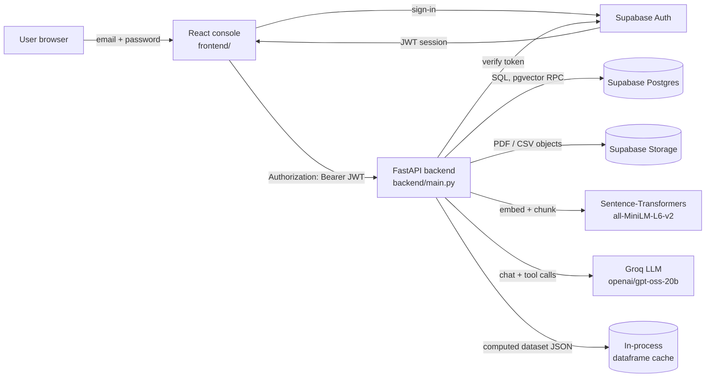

# InsightForge

InsightForge is an AI research and data-analysis workspace: upload a PDF and ask grounded, page-cited questions about it, load a CSV and explore it with interactive charts, flag multi-dimensional outliers with IsolationForest, or hand a goal to a tool-calling agent that decides which of those capabilities to use and writes a Markdown report. Documents and datasets are stored in Supabase (Postgres + pgvector + Storage), embeddings are produced locally with `all-MiniLM-L6-v2`, and the language model is Groq's `openai/gpt-oss-20b` (configurable). A FastAPI backend exposes every capability behind Supabase-issued JWTs; a single-file Streamlit app is the UI.

## Features by tab

### 📄 Research Paper Q&A
- PDF ingestion with PyMuPDF: page-tagged chunks, 384-dimensional MiniLM embeddings stored in pgvector.
- Retrieval-augmented answers that cite `[page N]` for each claim, with de-duplicated page citations ranked by similarity.
- If no chunk passes the similarity cut-off, the API retries unfiltered once and otherwise says the paper doesn't cover the question — it never fabricates an answer.
- Per-user isolation: every retrieval query is scoped to the authenticated user's `document_id`.

### 📊 Tabular Analytics
- CSV ingest with encoding fallback (UTF-8/UTF-8-BOM/latin-1) and a pandas EDA summary: dtypes, null rates, unique counts, descriptive statistics.
- KPI cards for rows, columns, missing-value rate and model-eligible numeric columns.
- Plotly studio (scatter, line, bar, histogram) with automatic sampling above 20k rows for responsiveness.

### 🚨 Anomaly Detection
- IsolationForest over selected numeric columns, with a contamination slider from **0.01 to 0.20** (default 0.05).
- **Label-leakage guard:** columns whose name contains `truth`, `label`, `target`, `is_anomaly` or `id` are excluded from modelling and surfaced in the UI as *"Excluded from model: …"*.
- Optional feature multiselect (defaults to all non-excluded numeric columns); the server re-validates the selection and can never be tricked into using a label column.
- Exact duplicate rows are dropped before fitting; missing values are median-imputed.
- Flagged rows are highlighted in a preview table with their IsolationForest decision score.

### 🤖 Agent & Report
- Groq function-calling agent with three tools: `search_papers`, `describe_data`, `detect_anomalies`.
- Bounded loop (4 iterations) that records every tool call, its arguments and its result.
- Grounding rules in the system prompt: cite only retrieved page numbers, quote only computed statistics, never connect a paper to a dataset without a relevant passage.
- The anomaly tool returns **computed JSON only** (counts, per-category anomaly rates vs. the overall base rate, min/max/mean/median for anomalous vs. normal rows) — the LLM never does arithmetic and never sees raw rows.
- Reports and run traces are persisted to Supabase (`agent_runs`, `reports`).

## Architecture



Request path: the React console signs in against Supabase, stores the access token, and attaches `Authorization: Bearer <token>` to every backend call. The backend validates that token with Supabase, derives the user id, and scopes every query and storage path to it. Uploads are parsed and validated (size, type, row/column/page caps) before anything is written. Rate limiting runs per user id (IP for anonymous calls).

## Tech stack

| Layer | Technology |
| --- | --- |
| API | FastAPI 0.162, Uvicorn 0.54, Pydantic v2 |
| Rate limiting | slowapi 0.1.10 |
| Frontend | Streamlit 1.66, Plotly 7.1, pandas 3.1 |
| Database / storage / auth | Supabase (Postgres + pgvector, Storage, GoTrue JWT) |
| PDF + embeddings | PyMuPDF 2.0, sentence-transformers 6.2 (`all-MiniLM-L6-v2`, 384-d) |
| Tabular / ML | pandas, scikit-learn 1.9 (IsolationForest) |
| LLM | Groq 1.7, `openai/gpt-oss-20b` (function calling) |

## Setup

### 1. Prerequisites
- Python 3.14.7 (the version every pin below was resolved against; see `runtime.txt`)
- A Supabase project with the `vector` extension enabled, plus the tables/RPC used by `backend/db.py` (`documents`, `chunks`, `datasets`, `agent_runs`, `reports`, `chat_history`, and the `match_chunks` + `hybrid_search_chunks` functions). New migrations live in `supabase/migrations/`; run each file once in the Supabase SQL Editor (`20261103000000_chat_history.sql` creates the chat table and its RLS policies, `20261103000100_hybrid_search.sql` adds the full-text column and the RRF ranking function).
- A Groq API key.

### 2. Install
```bash
cd insightforge
python -m venv .venv
# Windows: .\.venv\Scripts\activate
source .venv/bin/activate

pip install -r requirements.txt   # backend (FastAPI, CPU-only torch)
cd frontend && npm install                # React console (Vite + Tailwind v4)
```

### 3. Configure
```bash
cp .env.example .env
```
Fill in `SUPABASE_URL`, `SUPABASE_ANON_KEY`, `SUPABASE_SERVICE_ROLE_KEY`, `GROQ_API_KEY` and `BACKEND_URL`. Leave `MATCH_THRESHOLD` blank for the default (0.05) unless you have measured a better cut-off for your corpus.

### 4. Run the backend (single worker)
```bash
uvicorn backend.main:app --host 0.0.0.0 --port 8000 --workers 1
```
`--workers 1` is required: analysed dataframes are cached in process memory keyed by `dataset_id`. Docs: `http://<host>:8000/docs`, health: `http://<host>:8000/health`.

### 5. Run the frontend
```bash
cd frontend
npm run dev          # http://127.0.0.1:5173
```
Set `VITE_API_URL`, `VITE_SUPABASE_URL` and `VITE_SUPABASE_ANON_KEY` in `frontend/.env`, and make sure the console's origin is in `ALLOWED_ORIGINS` on the API (`5173` and `4173` are the defaults).

### Deployment notes
- **Python version: 3.14.7.** `runtime.txt` pins `python-3.14.7` for Render; set Render's `PYTHON_VERSION` env var to `3.14.7` if you prefer the dashboard. The pins (torch 2.15, scikit-learn 1.9, pandas 3.1) are built for this interpreter — a different minor version will fail to resolve wheels.
- **Backend:** any container host works (Render, Railway, Fly.io, a VM). Build from the `insightforge` directory so the root `requirements.txt` and `runtime.txt` are found (Railway detects the Python service from that root requirements file). Start with a single worker and a persistent process; the first request loads MiniLM, so give the instance ~1 GB RAM.
- **Frontend:** any static host (Cloudflare Pages, Netlify, Vercel) or a container running `npm run build` + `vite preview`. Provide `VITE_API_URL`, `VITE_SUPABASE_URL` and `VITE_SUPABASE_ANON_KEY` at build time — never the service-role key, and remember Vite inlines `VITE_*` values into the bundle. Allow the console's URL under Supabase → Authentication → URL configuration so confirmation emails link back to it.
- **CORS:** `ALLOWED_ORIGINS` is an exact, comma-separated origin allow-list (scheme + host + optional port, no paths, no trailing slash, no `*`) with credentials enabled and only `GET`/`POST`/`OPTIONS` plus `Authorization`/`Content-Type`/`Accept` headers permitted. Left unset it falls back to `http://localhost:5173`, `http://127.0.0.1:5173`, `http://localhost:4173` and `http://127.0.0.1:4173`; set it to your own frontend origin when you fork the repo.
- **Rate limits** are in-memory (slowapi default). Multiple API instances each keep their own counters; for a shared budget, point slowapi at Redis.

## Environment variables

| Variable | Used by | Required | Default | Purpose |
| --- | --- | --- | --- | --- |
| `SUPABASE_URL` | backend + frontend | yes | – | Supabase project URL |
| `SUPABASE_ANON_KEY` | backend + frontend | yes | – | Public key for sign-in and token verification |
| `SUPABASE_SERVICE_ROLE_KEY` | backend only | yes | – | Server-side DB/storage access (bypasses RLS) |
| `GROQ_API_KEY` | backend | yes | – | LLM + agent calls |
| `MATCH_THRESHOLD` | backend | no | `0.05` | pgvector cosine cut-off; MiniLM scores are compressed |
| `ALLOWED_ORIGINS` | backend | no | localhost:8501, 127.0.0.1:8501, deployed Streamlit app | Exact comma-separated CORS allow-list; trailing slashes are stripped, `*` is ignored |
| `BACKEND_URL` | frontend | yes (deployed) | `http://127.0.0.1:8000` | Base URL of the FastAPI service |
| `APP_URL` | frontend | no | – | Public URL used as the sign-up confirmation redirect (`st.secrets["APP_URL"]`); omitted from the request when unset |
| `INSIGHTFORGE_TIMEOUT` | frontend | no | `180` | HTTP timeout (seconds) |
| `MAX_UPLOAD_MB` | backend | no | `15` | PDF size cap |
| `MAX_DATASET_MB` | backend | no | `10` | CSV size cap |
| `MAX_CSV_ROWS` | backend | no | `100000` | CSV row cap |
| `MAX_CSV_COLUMNS` | backend | no | `50` | CSV column cap |
| `MAX_PDF_PAGES` | backend | no | `50` | PDF page cap |
| `RATE_LIMIT_UPLOAD` | backend | no | `5/minute` | Upload budget per user |
| `RATE_LIMIT_QA` | backend | no | `10/minute` | Paper Q&A budget |
| `RATE_LIMIT_ANOMALIES` | backend | no | `10/minute` | Anomaly scan budget |
| `RATE_LIMIT_AGENT` | backend | no | `10/minute` | Agent run budget |

### API error contract

| Status | Meaning | Frontend behaviour |
| --- | --- | --- |
| `401` | Missing, invalid or expired JWT | Clears the session, shows "Session expired, please log in again." |
| `413` | Upload exceeds the size cap | Error with the exact MB limit |
| `415` | Wrong content type | Error naming the received type |
| `422` | CSV too many rows/columns, PDF too many pages, bad contamination | Error with the limit that was exceeded |
| `429` | Per-user rate limit hit | **Warning** with a retry hint, not an error |
| `503` | Groq or the embedding model is unavailable | Friendly "try again in a moment" message |

## Upload limits

| Resource | Limit | Response |
| --- | --- | --- |
| PDF size | 15 MB | `413` |
| PDF pages | 50 | `422` |
| CSV size | 10 MB | `413` |
| CSV rows | 100,000 | `422` |
| CSV columns | 50 | `422` |
| File types | `.pdf` and `.csv` only, checked by extension **and** content type | `400` / `415` |

## Benchmark: anomaly detection

`benchmarks/benchmark_anomalies.py` scores IsolationForest against the synthetic ground truth in `benchmarks/complex_metrics_test.csv`. Run it with:

```bash
python benchmarks/benchmark_anomalies.py
```

The dataset is **synthetic**: 601 rows of service telemetry (`service`, `region`, latency, CPU, error rate, throughput, memory) with 27 deliberately injected multi-dimensional anomalies (4.49%). The `is_anomaly` column is excluded from the feature set by the leakage guard and used only for scoring.

| Contamination | Flagged | TP | FP | FN | Precision | Recall | F1 |
| --- | --- | --- | --- | --- | --- | --- | --- |
| 0.02 | 12 | 12 | 0 | 15 | 1.000 | 0.444 | 0.615 |
| 0.05 | 30 | 27 | 3 | 0 | 0.900 | 1.000 | 0.947 |
| 0.10 | 60 | 27 | 33 | 0 | 0.450 | 1.000 | 0.621 |

Reading the table: the injected anomalies are well separated, so recall saturates as soon as the budget reaches ~4.5% of rows. Contamination above the true anomaly rate mainly adds false positives. **These numbers come from synthetic data and should not be read as expected performance on real telemetry.**

## Known limitations

- **In-memory dataset cache:** analysed dataframes live in one process, keyed by `dataset_id` and bounded to 50 entries. A restart, a second worker, or a cache eviction makes `/dataset/{id}/anomalies` return 404 — the CSV must be re-uploaded. This is why the API must run with a single worker.
- **Free-tier cold starts:** Render/Railway/Streamlit Community Cloud sleep idle apps. The first request after sleep loads the embedding model and can take 30–60 s; streaming timeouts are raised to 180 s by default to absorb this.
- **Model memory:** `sentence-transformers` + torch need roughly 1 GB RAM. Small free instances may OOM while embedding a 50-page PDF.
- **MiniLM similarity scores are compressed:** strongly relevant chunks often score only 0.25–0.45, which is why `MATCH_THRESHOLD` defaults to a low 0.05 and retrieval ranks rather than filters.
- **Rate limiting is per process:** counters reset on restart and are not shared between instances.
- **Agent loop is bounded:** 4 tool iterations; complex goals may finish with status `max_iterations`.
- **PDF text only:** scanned documents need OCR before upload.
- **No background jobs:** PDF ingestion and agent runs execute inside the request; very long documents rely on the client timeout.
- **Single LLM provider:** Groq outages return `503`; there is no fallback provider.

## Screenshots

> _Placeholder — add screenshots of the four tabs here._

| Paper Q&A | Analytics |
| --- | --- |
| `docs/screenshots/paper-qa.png` | `docs/screenshots/analytics.png` |

| Anomalies | Agent & Report |
| --- | --- |
| `docs/screenshots/anomalies.png` | `docs/screenshots/agent.png` |

## Demo video

> _Placeholder — add a 60–90 s walkthrough (upload → ask → scan → agent report)._

`docs/demo.mp4`

## Repository layout

```
insightforge/
├── frontend/                    # React console (Vite + Tailwind v4)
│   ├── src/App.jsx              # auth gate, sidebar, RAG chat, export bar
│   ├── src/api.js               # backend bridge
│   └── src/components/          # Uploader, AnomalyPanel (Plotly)
├── backend/
│   ├── main.py                  # FastAPI routes, auth, limits, rate limiting
│   ├── db.py                    # Supabase helpers (service-role client)
│   ├── analytics.py             # EDA + IsolationForest + leakage guard
│   ├── pdf_rag.py               # PDF parsing, chunking, MiniLM embeddings
│   ├── agent.py                 # Groq tool-calling agent
│   └── brief_export.py          # Markdown brief -> PDF renderer
├── requirements.txt             # backend pins (root, for Railway detection)
├── benchmarks/
│   ├── benchmark_anomalies.py
│   └── complex_metrics_test.csv
├── .env.example
└── .gitignore
```
