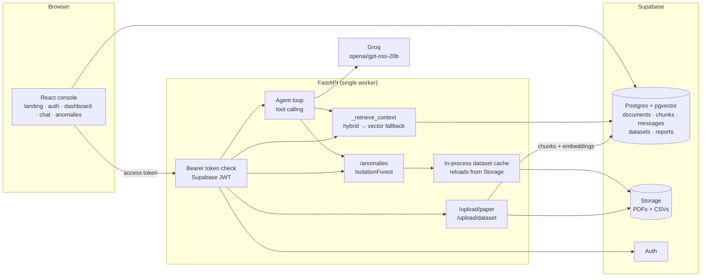

# InsightForge

Ask a research paper a question, then check its claim against a dataset.

Most "chat with your PDF" tools stop at retrieval. Most dashboards stop at a
chart. The interesting question sits between them, and this console is built
around it:

> **Does the paper's claim match the dataset's outliers?**

Upload a claim sheet and a field survey, ask that, and you get an answer that
quotes the page the claim came from and the computed count that agrees or
disagrees with it.

## What it does

- **Retrieval-grounded answers over PDFs.** Pages are chunked into 500-word
  windows with 50 words of overlap, embedded with MiniLM into pgvector, and
  fused with Postgres full-text search by reciprocal-rank fusion. Every answer
  cites the pages it drew from, and a question whose best chunk scores below
  0.30 comes back as *"this paper does not cover that"* rather than a guess.
- **Server-side statistics on CSVs.** Row and column counts, missing values,
  numeric ranges and per-column profiles are computed in pandas, never by the
  model. An IsolationForest screen reports outliers as structure — which
  columns drove the flag, which categories are over-represented — instead of a
  list of suspicious rows to eyeball.
- **A tool-calling agent that refuses to invent.** Groq's `gpt-oss-20b` chooses
  between `search_papers`, `describe_data` and `detect_anomalies`; the tools
  return computed payloads, and the prompt forbids stating a number no tool
  produced.

## The headline example

`demo/` ships two files: a two-page claim sheet and a 55-row field survey.

| Claim (page 2) | What the survey shows |
|---|---|
| 71% of contaminated captures happened between 19:00 and 05:00 | 9 rows flagged; 7 are night captures = **77.8%** |
| No untreated plot exceeded 60% lesion coverage | highest flagged lesion score is **91.7%** |

The direction agrees and the magnitude does not — which is exactly the kind of
answer a retrieval tool alone cannot give you. Steps:

1. **Overview → Add a paper** → upload `demo/potato-blight-claim.pdf`.
2. **Outliers & Anomalies** → upload `demo/potato-blight-field.csv` → run at
   contamination `0.15`.
3. **Research Chat** → select the claim sheet → ask *"Does the paper's claim
   match the dataset's outliers?"*

Full detail, including how the CSV is generated: [`demo/README.md`](demo/README.md).

## Architecture



## Stack and why

| Choice | Why this one |
|---|---|
| React + Vite | Three separate entry points (`index`, `landing`, `auth`) from one build, and Plotly can stay in a lazy chunk instead of the chat bundle. |
| FastAPI, one worker | The dataset cache is per process, so a single worker is a correctness decision, not a limitation to work around. |
| Postgres + pgvector via Supabase | Vector search, full-text search, auth and file storage in one managed service, with RLS as a second line of defence behind the API's own ownership checks. |
| `all-MiniLM-L6-v2` | 384 dimensions, fast on CPU, and small enough to embed a 50-page paper inside a request timeout. The trade-off is that its cosine scores are compressed, hence the low 0.05 floor and the 0.30 answer cut-off. |
| IsolationForest | No labelled anomalies exist in farm data, so the screen has to be unsupervised; 200 trees on a few thousand rows is milliseconds. |
| Groq `gpt-oss-20b` | Tool calling with a latency budget a chat UI can tolerate. |

## Setup

```bash
# 1. Backend
python -m venv .venv
source .venv/Scripts/activate        # Windows; use .venv/bin/activate elsewhere
pip install -r requirements.txt -r backend/requirements-dev.txt

# 2. Frontend
cd frontend && npm install && cd ..

# 3. Configuration
cp .env.example .env                 # fill in your own values
cp .env.example frontend/.env        # the VITE_* lines are what Vite reads

# 4. Database
# Apply supabase/migrations/*.sql in order (SQL editor or `supabase db push`).

# 5. Run
uvicorn backend.main:app --port 8000 --workers 1   # terminal 1
cd frontend && npm run dev                          # terminal 2, http://localhost:5173
```

## Environment variables

Everything the service reads is listed in [`.env.example`](.env.example) with
placeholder values. The required ones:

| Variable | Purpose |
|---|---|
| `SUPABASE_URL`, `SUPABASE_ANON_KEY`, `SUPABASE_SERVICE_ROLE_KEY` | Database, storage and token verification. The service-role key never leaves the server. |
| `VITE_SUPABASE_URL`, `VITE_SUPABASE_ANON_KEY`, `VITE_API_URL` | Browser-side sign-in and API base URL. |
| `GROQ_API_KEY` | Agent and answer generation. |
| `ALLOWED_ORIGINS` / `ALLOWED_ORIGIN_REGEX` | CORS allow-list; generated Vercel previews are matched by regex. |

Tuning knobs (`MATCH_THRESHOLD`, `HYBRID_RRF_K`, chunk geometry, upload caps,
rate limits) are documented inline in the same file.

## Tests

```bash
npm test --prefix frontend     # 7 Vitest + Testing Library specs
python -m pytest               # 29 pytest cases
```

The frontend suite covers the paths that used to be checked by hand: a failed
send hands the question back, a paper switch mid-flight drops the stale answer,
a second Enter does not open a second request, and the uploader rejects a wrong
extension, an empty file and an oversize file with the right message. The
backend suite covers chunk geometry, the hybrid→vector fallback, the 0.30
relevance cut-off, upload validation, the CORS pattern and the anomaly payload.
Neither suite touches the network: Supabase, Groq and the embedding model are
stubbed.

## Evaluation

```bash
python eval/evaluate.py        # rewrites eval/RESULTS.md
```

24 key-phrase questions over three sample papers, scored with the production
chunker. Latest run:

| Ranker | hit@1 | hit@3 | MRR |
|---|---|---|---|
| vector-only | 50.0% | 87.5% | 0.684 |
| full-text (BM25) | 79.2% | 87.5% | 0.844 |
| hybrid RRF | 66.7% | **91.7%** | 0.785 |

Hybrid wins on hit@3 — the fetches that include a decisive chunk — while BM25
wins on hit@1 on this corpus. Twelve chunks is a regression baseline, not a
benchmark, and the full-text column uses local BM25 as a stand-in for Postgres
`ts_rank_cd`; both caveats are stated in `eval/RESULTS.md`.

## Limitations

- **A 20B model is the ceiling of the prose.** `gpt-oss-20b` writes the
  explanation but never the numbers. It can still phrase a correct computation
  clumsily, and it cannot reason across two papers at once.
- **The dataset cache is in memory.** A restart empties it; the CSV is then
  reloaded from Supabase Storage on the next request, which costs a parse.
  Multi-worker deployments would give inconsistent caches, hence `--workers 1`.
- **50-page PDF cap.** Longer papers are rejected with a 422 rather than
  silently truncated, because a partial index makes "the paper doesn't cover
  that" a false statement.
- **Row and column caps.** 100,000 rows and 50 columns per CSV; 15 MB for a PDF
  and 10 MB for a CSV. The screen refuses rather than samples.
- **No social sign-in yet.** Google and GitHub buttons are built and hidden
  behind `SOCIAL_SIGNIN_ENABLED`; email and password is the only live path.
- **One paper
 per conversation.** The agent is scoped to a single document, so
  cross-paper synthesis is a future feature rather than a current claim.
- **Drift and drift-like error are invisible to the CSV screen.** IsolationForest
  finds rows that are unusual, not rows that are wrong for a reason it cannot
  see.

## Secrets

No key material is committed. `.env` is ignored and has never been tracked; the
only occurrences of the word `service_role` in history are SQL grant statements
and documentation strings. `git log -S"gsk_"` returns nothing, so no Groq key
was ever committed. If you fork this, rotate anything you paste into a local
`.env` before sharing a screen.
